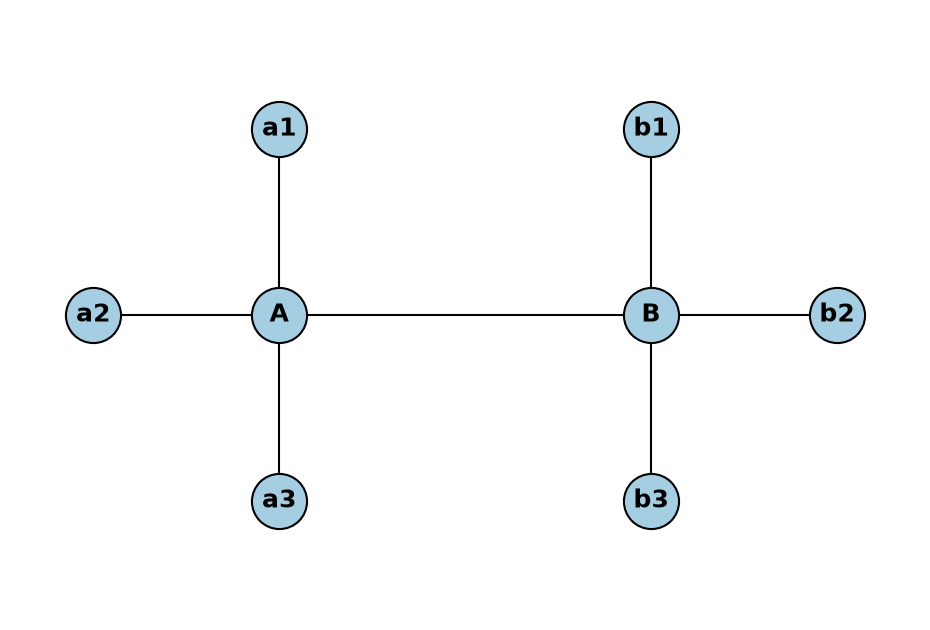
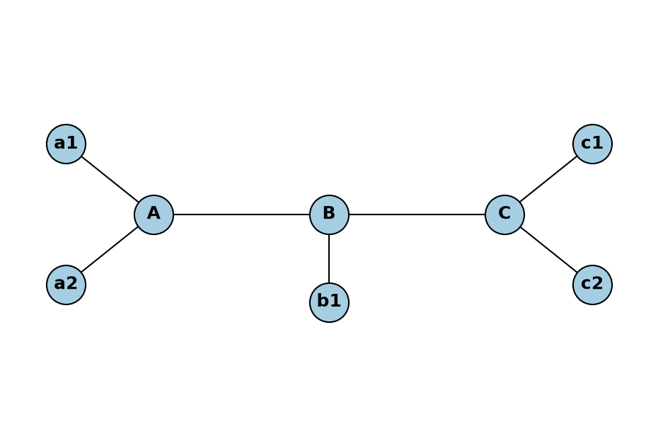
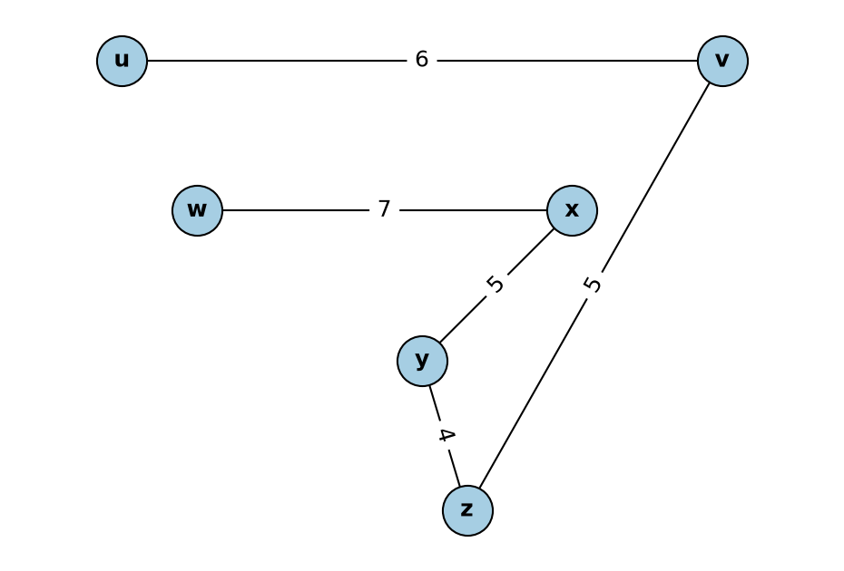
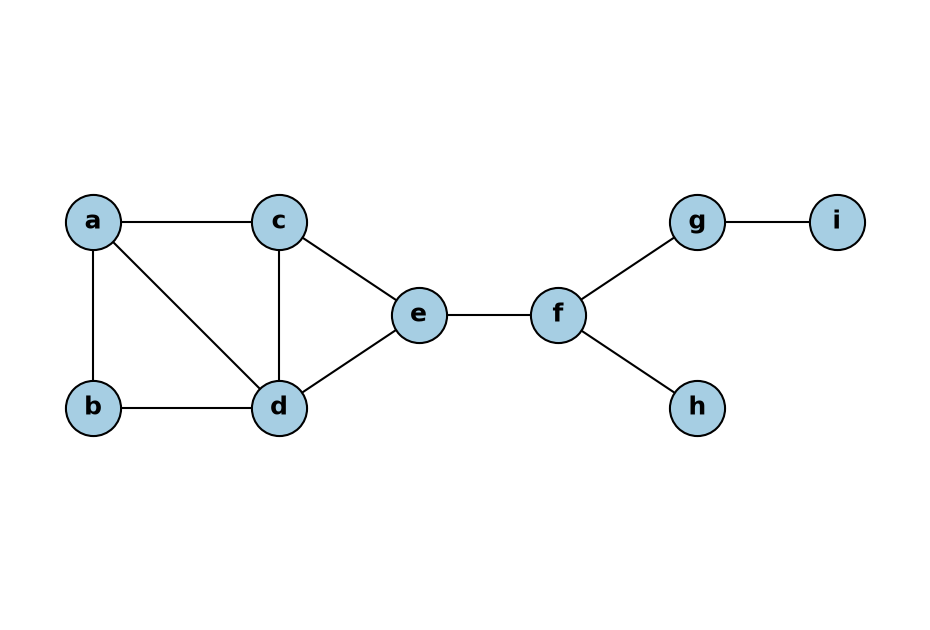

# Answers

## Number 1

Order 8, six vertices of degree 1, two vertices of degree 4.

- A connects to a1, a2, a3 and B, so deg(A) = 4.
- B connects to b1, b2, b3 and A, so deg(B) = 4.
- a1, a2, a3, b1, b2 and b3 each have degree 1.
- Check: the degree sum is 6(1) + 2(4) = 14, so there are 14 / 2 = 7 edges.

## Number 2

Order 8, degree sequence 3, 3, 3, 1, 1, 1, 1, 1.

- deg(A) = 3 (a1, a2, B)
- deg(B) = 3 (A, C, b1)
- deg(C) = 3 (B, c1, c2)
- a1, a2, b1, c1 and c2 each have degree 1.

Why it is a tree:

1. It is connected. You can go from any vertex to any other vertex.
2. It has no cycle. You cannot start at a vertex and come back to it without using an edge again.
3. It has 8 vertices and 7 edges, which is n - 1. A connected graph with n - 1 edges is always a tree.

## Number 3

Kruskal algorithm changed for a maximum spanning tree:

1. List all the edges. Sort them from the **largest** weight to the smallest.
2. Take the next edge in the list.
   - If it does not make a cycle, add it to the tree.
   - If it makes a cycle, skip it.
3. Do step 2 again until the tree has n - 1 edges, where n is the number of vertices.

The only change from normal Kruskal is the sort order. Normal Kruskal sorts from the smallest weight. This one sorts from the largest weight.

## Number 4

Result (maximum spanning tree):

| Order | Edge | Weight |
|-------|------|--------|
| 1 | x–w | 7 |
| 2 | u–v | 6 |
| 3 | v–z | 5 |
| 4 | x–y | 5 |
| 5 | y–z | 4 |

Total weight = 7 + 6 + 5 + 5 + 4 = **27**

## Number 5

- **Cut vertex:** a vertex that splits the graph into more pieces when you remove it.
- **Bridge:** an edge that splits the graph into more pieces when you remove it.
- **Block:** a largest connected piece of the graph that has no cut vertex of its own.
- **Branch (of a cut vertex v):** a piece left when you remove v, with v put back.

**a) Cut vertices: 3**

{e, f, g}

**b) Branches**

- Branches of e: 2 → {a, b, c, d, e} and {e, f, g, h, i}
- Branches of f: 3 → {a, b, c, d, e, f}, {f, g, i} and {f, h}
- Branches of g: 2 → {a, b, c, d, e, f, g, h} and {g, i}

**c) Blocks: 5**

- B1: {a, b, c, d, e}
- B2: e–f
- B3: f–h
- B4: f–g
- B5: g–i

**d) Bridges: 4**

e–f, f–g, g–i, f–h
